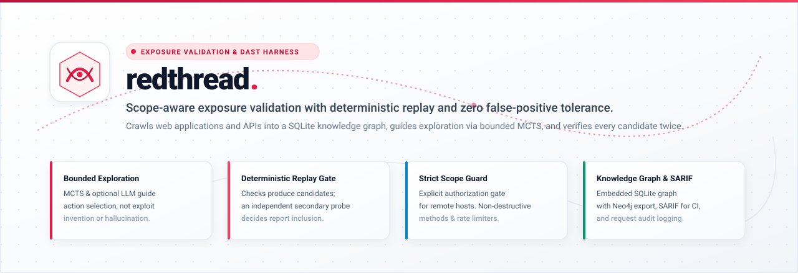
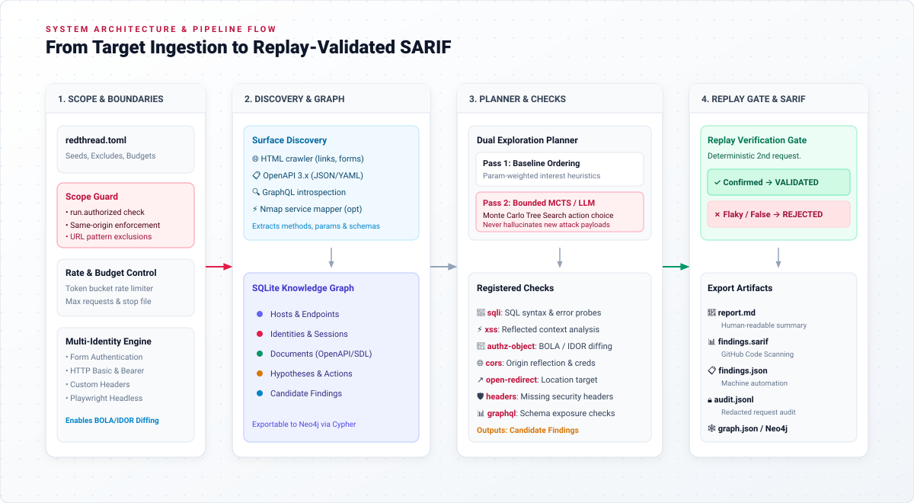
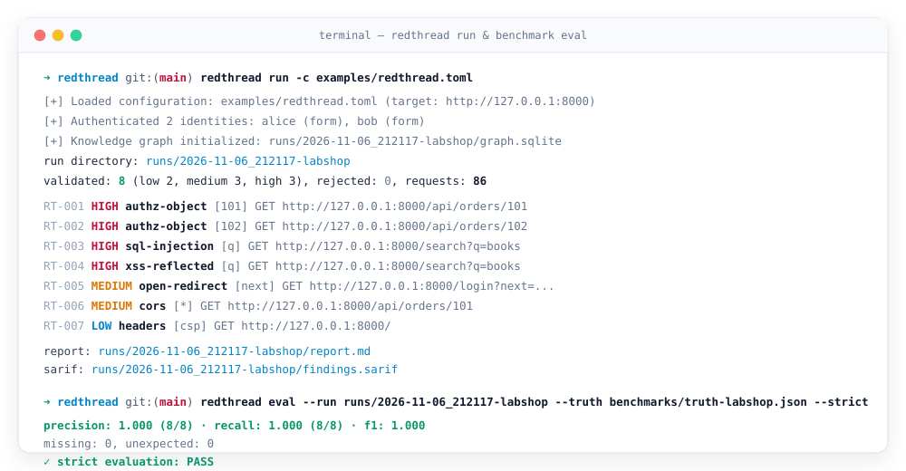

<div align="center">



<br />

[](https://github.com/abdulraheem-cyber/redthread/actions/workflows/ci.yml)
[](https://www.python.org/)
[](LICENSE)
[](https://github.com/astral-sh/ruff)
[](https://github.com/abdulraheem-cyber/redthread)

<p align="center">
  <strong>Scope-aware exposure validation harness for web applications and APIs.</strong><br />
  Combines crawler discovery, a graph-based state model, and bounded MCTS exploration<br />
  with strict two-stage candidate replay to eliminate false positives.
</p>

[Quickstart](#quickstart-in-2-minutes) • [Architecture](#architecture) • [Registered Checks](#registered-checks) • [CLI Commands](#cli-reference) • [Configuration](#configuration) • [Documentation](docs/)

</div>

<hr />

## Overview

Traditional web vulnerability scanners tend to suffer from two opposing problems: blind fuzzers produce overwhelming false-positive noise, while unconstrained LLM-driven testing agents risk hallucinating non-existent exploits or generating unsafe mutations.

**redthread** takes a pragmatic, bounded approach:

1. **Deterministic Discovery**: Surfaces endpoints, forms, OpenAPI definitions, and GraphQL schemas into an embedded SQLite knowledge graph.
2. **Bounded Action Planning**: A planner (guided by Monte Carlo Tree Search or an optional OpenAI-compatible model) selects which discovered action or check to investigate next. It is *never* permitted to invent attack techniques or declare findings directly.
3. **Two-Stage Replay Gate**: Checks only generate *candidate* findings. A candidate is only promoted to a confirmed finding if an independent, deterministic secondary request validates it. Rejected candidates are preserved in audit logs rather than discarded.
4. **Strict Scope Safeguards**: Non-loopback targets require explicit authorization flags, requests use safe HTTP methods by default (GET, HEAD, OPTIONS), and token-bucket rate limits are enforced throughout.

---

## Architecture

The diagram below outlines the redthread pipeline from target configuration to verified SARIF report:

<div align="center">
  
</div>

### Core Pipeline Stages

1. **Scope & Safety Enforcement**: Loads `redthread.toml`, verifies `run.authorized` for remote hosts, compiles path inclusion/exclusion patterns, and enforces rate and request budgets.
2. **Discovery & Session Management**: Authenticates configured identities (Form, Basic, Bearer, Headers, or Playwright browser) and crawls HTML links, OpenAPI descriptions, and GraphQL schemas.
3. **SQLite Knowledge Graph**: Relates hosts, endpoints, HTTP parameters, identities, schemas, hypotheses, and actions into a unified queryable state (exportable to Neo4j).
4. **Exploration Engine**: Executes a prioritized baseline check pass, followed by an MCTS exploration pass that evaluates endpoints by parameter richness, authentication status, and API tags.
5. **Deterministic Checks & Replay**: Executes registered check logic. If anomalous behavior is detected, an isolated replay validation occurs.
6. **Artifact Generation**: Outputs structured findings as Markdown (`report.md`), machine-readable JSON (`findings.json`), GitHub Code Scanning SARIF (`findings.sarif`), and request audit trails (`audit.jsonl`).

---

## Live Demonstration

Here is an authentic run of `redthread` against the bundled vulnerable lab (`labs/labshop.py`), followed by benchmark ground-truth verification:

<div align="center">
  
</div>

---

## Registered Checks

| ID | Title | Default Severity | Detection Signal | Replay Validation Method |
| :--- | :--- | :---: | :--- | :--- |
| `authz-object` | Object-level Authorization Bypass | **High** | Dual-identity check: two authenticated identities receive identical response data for parameterized object resources | Replays both victim and attacker sessions alongside an anonymous probe to confirm true authorization failure |
| `sqli` | SQL Injection Syntax Error | **High** | Injected syntax triggers database syntax errors or distinct execution deviations | Issues controlled inversion and baseline probes to confirm syntax error specificity |
| `xss` | Reflected Cross-Site Scripting | **High** | Injected probe reflects unencoded into HTML or JavaScript context with executable boundary | Validates reflection context and verifies that escaping or filtering is genuinely absent |
| `cors` | Permissive CORS Configuration | **Medium** | Server reflects arbitrary untrusted `Origin` and sets `Access-Control-Allow-Credentials: true` | Replays with controlled arbitrary origins and verifies origin persistence |
| `open-redirect` | Unvalidated Redirect | **Medium** | Target redirects directly to external test domain via parameter | Replays target parameter and confirms 3xx response and `Location` header validity |
| `headers` | Missing Security Headers | **Low** | Absence of CSP, `X-Content-Type-Options`, framing protection, or software version disclosure | Evaluated once per origin across baseline responses |
| `graphql` | GraphQL Schema & Introspection | **Medium** | GraphQL introspection enabled or schema accessible without authentication | Validates schema payload via standard `__schema` introspective query replay |

Detailed check specifications and implementation details are documented in [docs/checks.md](docs/checks.md).

---

## Quickstart in 2 Minutes

### 1. Installation

Requires **Python 3.11** or newer:

```bash
# Clone the repository
git clone https://github.com/abdulraheem-cyber/redthread.git
cd redthread

# Create and activate virtual environment
python -m venv .venv

# On Linux/macOS:
source .venv/bin/activate
# On Windows:
.venv\Scripts\activate

# Install core dependencies with developer tools
pip install -e ".[dev]"
```

*Optional extras:*
```bash
# Playwright browser authentication, YAML OpenAPI support, and Neo4j export
pip install -e ".[browser,yaml,neo4j]"
```

### 2. Run Against the Bundled Vulnerable Lab

The repository includes `labs/labshop.py`, a self-contained vulnerable application with authentication, SQL injection, reflected XSS, open redirects, CORS misconfigurations, and BOLA/IDOR endpoints.

**Terminal 1 — Start the Lab:**
```bash
python -m labs.labshop --port 8000
```

**Terminal 2 — Run the Scanner:**
```bash
# 1. Validate configuration and effective scope without sending traffic
redthread validate -c examples/redthread.toml

# 2. Execute the scan
redthread run -c examples/redthread.toml
```

**Score Findings Against Ground Truth:**
```bash
redthread eval --run runs/<latest-run-directory> --truth benchmarks/truth-labshop.json --strict
```

---

## CLI Reference

| Command | Description | Useful Flags |
| :--- | :--- | :--- |
| `redthread run` | Executes an assessment run | `-c CONFIG`, `--fail-on [low\|medium\|high]`, `--no-llm`, `--no-explore`, `--json`, `--quiet` |
| `redthread watch` | Runs repeated assessments on a timer | `-c CONFIG`, `--interval SECONDS`, `--max-runs COUNT` |
| `redthread validate` | Parses config and prints effective scope without making requests | `-c CONFIG` |
| `redthread init` | Generates a starter TOML configuration file | `PATH`, `--force` |
| `redthread checks` | Lists all registered checks and their default severities | — |
| `redthread eval` | Evaluates run findings against a ground-truth JSON benchmark | `--run DIR`, `--truth FILE`, `--strict` |
| `redthread export-neo4j` | Exports run graph into Neo4j via Cypher statements | `--run DIR`, `--uri URI`, `--user USER`, `--password PASS` |

---

## Configuration

Configurations are written in TOML. String values support `${ENV_VAR}` expansion.

```toml
[run]
name = "staging-api"
output_dir = "runs"
authorized = false         # Must be explicitly true for non-loopback hosts
allow_post = false         # Enables POST for form auth and GraphQL queries
rate_limit = 4.0           # Maximum requests per second (token bucket)
max_requests = 800         # Total request budget cap
max_runtime_seconds = 900  # Hard timeout in seconds
workers = 4

[scope]
include = ["https://staging.example.test"]
exclude = ["/logout", "/admin/delete*"]
max_depth = 3
max_pages = 80
same_origin = true

[checks]
enabled = []               # Empty list runs all registered checks
disabled = ["headers"]     # Explicitly disable specific check IDs

[integrations]
nmap_enabled = false

[[identities]]
name = "analyst"
kind = "form"
login_url = "https://staging.example.test/login"
username = "${TEST_USER}"
password = "${TEST_PASSWORD}"
success_marker = "Dashboard"
```

An annotated configuration template is available in [`examples/redthread.toml`](examples/redthread.toml).

---

## Run Artifacts

Every scan run creates an isolated directory inside `runs/` containing:

* **`report.md`**: Human-readable markdown report with finding details, CVSS scores, remediation guidance, and evidence snippets.
* **`findings.sarif`**: Industry-standard SARIF format compatible with GitHub Code Scanning alerts and security dashboards.
* **`findings.json`**: Structured JSON array containing confirmed findings, confidence scores, and raw proof payloads.
* **`graph.sqlite`**: Complete snapshot of discovered endpoints, relationships, parameter types, and executed action keys.
* **`audit.jsonl`**: Complete request/response log with automatic redaction of sensitive authentication tokens and headers.

---

## Project Structure

```text
redthread/
├── .github/                  # CI workflows and community templates
│   ├── ISSUE_TEMPLATE/       # Bug report and feature request templates
│   ├── workflows/ci.yml      # Multi-version Python CI pipeline
│   └── pull_request_template.md
├── assets/                   # Architecture diagrams, banners, and vector assets
├── benchmarks/               # Ground-truth datasets for precision/recall eval
├── docs/                     # Deep-dive architectural documentation
│   ├── architecture.md       # State graph, planner, and agent model
│   ├── benchmarks.md         # Precision & recall scoring methodology
│   ├── checks.md             # In-depth detection logic for all checks
│   ├── prior-art.md          # Comparison with ZAP, Caido, Nuclei, and DASTs
│   └── safety.md             # Scope boundary rules and non-destructive policies
├── examples/                 # Sample TOML configuration files
├── labs/                     # Standalone deliberately vulnerable test shop
├── src/redthread/            # Application source code
│   ├── agents/               # Autonomous crawler, auth, and scan agents
│   ├── checks/               # Deterministic vulnerability check modules
│   ├── integrations/         # OpenAPI, GraphQL, Nmap, and Neo4j drivers
│   ├── audit.py              # Request logging and token redaction
│   ├── cli.py                # Command-line interface definitions
│   ├── config.py             # TOML configuration loader and validator
│   ├── graph.py              # SQLite state graph operations
│   ├── http.py               # Rate-limited HTTP client session wrapper
│   ├── orchestrator.py       # Scan execution lifecycle coordinator
│   ├── planner.py            # MCTS exploration planner
│   ├── reporting.py          # Markdown, JSON, and SARIF serializers
│   └── scope.py              # URL matching and authorization validator
└── tests/                    # Unit, integration, and end-to-end test suite
```

---

## Safety & Ethics

redthread is built specifically for **authorized assessment work**, local developer testing, and CI/CD security validation.

* **Authorization Lock**: The scanner refuses to make requests to non-loopback domains unless `run.authorized = true` is set in configuration.
* **Non-Destructive Operations**: Only safe HTTP methods (`GET`, `HEAD`, `OPTIONS`) are permitted by default. `POST` is strictly guarded and restricted to authentication forms and GraphQL queries. There is zero support for `PUT`, `PATCH`, `DELETE`, or file uploads.
* **Safe Emergency Abort**: Any run monitoring a `stop_file` path terminates within milliseconds if the stop file is touched.

Review [`docs/safety.md`](docs/safety.md) for full operational guidelines.

---

## Contributing

Contributions are welcomed. Please review [`CONTRIBUTING.md`](CONTRIBUTING.md) and [`SECURITY.md`](SECURITY.md) before submitting pull requests or vulnerability reports.

To run the verification suite locally:

```bash
# Format and lint checks
ruff check .
ruff format --check .

# Run test suite
pytest
```

---

## License

This project is licensed under the [MIT License](LICENSE).
